# Agentic Bootstrap (`agentic-core`)

`agentic-core` creates a new web app for you with one command. People use each app in a browser. AI agents use the same app through its CLI and its MCP server, with the same rules.

## Why this exists

If an app has only web pages, an agent must scrape the pages or connect to the database directly. This repo starts every app with one typed API and three ways in:

- a **web app** for people,
- a **CLI** for scripts and agents,
- an **MCP server** that gives AI agents a list of tools.

All three call the same FastAPI API. Only the API reads and writes the database. So sign-in, per-user data, and input checks are the same for a person and for an agent.



Every new app gets:

- A Python FastAPI backend with a typed, documented API (`/docs`)
- A React web frontend with light mode, dark mode, and responsive layouts
- A CLI and an MCP server that call the API. The MCP server offers read tools only, until you turn on writes.
- Google sign-in for people, and agent keys for AI agents
- Its own Postgres database, plus a `compose.yaml` file that runs Postgres on your computer
- Tests, a linter, and GitHub Actions CI
- A `render.yaml` file that deploys the app on [Render](https://render.com)
- `DESIGN.md`, `CLAUDE.md`, and `AGENTS.md`, so coding agents follow the same rules

This repo is not an app. It holds the app template (`templates/mini-app/`) and the `agentic-core` command that fills it in.

**New to coding?** Read the [beginner guide](docs/beginner-guide.md) first. It explains Python, virtual environments, Postgres, FastAPI, and the other tools, and how to install them. Your coding agent can read it too, to explain a concept to you.

## Before you start

You need these tools on your computer. The [beginner guide](docs/beginner-guide.md#install-the-tools) has the install commands. Ask your coding agent to install any that are missing.

These steps work on macOS and Linux. On Windows, use [WSL](https://learn.microsoft.com/windows/wsl/install) and run every command inside it.

| Tool | Why | Check |
| --- | --- | --- |
| Python 3.12 or newer | Runs `agentic-core` and the app backend | `python3 --version` |
| Git | Saves your code | `git --version` |
| Node.js 22 or newer and pnpm | Runs the web frontend | `node --version` and `pnpm --version` |
| Docker | Runs Postgres on your computer | `docker compose version` |
| GitHub CLI, logged in | Creates the app's GitHub repo | `gh auth status` |
| Render CLI, logged in (optional) | Checks the deploy file before you deploy | `render whoami` |

The commands below use `python3`. If `python3 --version` shows a version older than 3.12, install a newer Python. Then use its command, for example `python3.12`, in place of `python3`. [uv](https://docs.astral.sh/uv/) also works: `uv venv --python 3.12 --seed .venv`.

## Install

Clone this repo into the folder that will hold your apps. New apps go next to it. The clone command names the folder `agentic-core`; the rest of this guide uses that name.

```bash
mkdir -p ~/Apps && cd ~/Apps
git clone https://github.com/matthewliu/matt-agentic-app-bootstrap.git agentic-core
cd agentic-core
python3 -m venv .venv
.venv/bin/pip install -e .
```

## Create your first app on your computer

This command makes the app folder only. It does not create a GitHub repo or call Render.

```bash
.venv/bin/agentic-core create-app my-first-app --description "My first app" --no-github --no-deploy
```

The app is now in `~/Apps/my-first-app`. Set it up and start the backend:

```bash
cd ../my-first-app
python3 -m venv .venv
.venv/bin/pip install -e ".[dev]"
.venv/bin/pytest
cp .env.example .env
docker compose up -d db
.venv/bin/my-first-app-migrate
.venv/bin/uvicorn app.main:app --reload
```

- `.venv/bin/pytest` runs the tests. They need no database.
- `docker compose up -d db` starts Postgres on your computer. `.env` already has the matching `DATABASE_URL`.
- `.venv/bin/my-first-app-migrate` creates the database tables.

Open http://localhost:8000/docs to see the API. In a second terminal, start the web frontend:

```bash
cd ~/Apps/my-first-app
pnpm install
pnpm -C frontend dev
```

Open http://localhost:5173. The app shows "Sign-in is not configured" until you set up Google sign-in. This is expected. The app gives no data to anyone until sign-in works. Follow the [Google sign-in walkthrough](docs/google-oauth-walkthrough.md).



Read the new app's `README.md` next. It tells you how to run, test, and deploy that app.

## Create an app with GitHub and Render

When you are ready to share the app, run the command without `--no-github` and `--no-deploy`. Open a new terminal, or stop a running server with Ctrl+C, then go back to the `agentic-core` folder:

```bash
cd ~/Apps/agentic-core
.venv/bin/agentic-core create-app my-app --description "What the app does"
```



This command:

1. Checks that the GitHub CLI and the Render CLI are logged in.
2. Creates the app folder and `render.yaml`.
3. Asks Render to check `render.yaml`. This creates nothing on Render.
4. Creates a private GitHub repo under the account that the GitHub CLI is logged in to, and pushes the code. To use another account or an organization, put `GITHUB_USER` on the same line: `GITHUB_USER=my-org .venv/bin/agentic-core create-app my-app --description "..."`.
5. Prints a link that deploys the app on Render.

The command does not create anything that costs money. You start the deploy when you open the link and apply the Blueprint in Render. That step creates a web service (about $7 per month) and a Postgres database (about $6 per month). Check the total in the Render dashboard before you confirm.

After the first deploy, set up Google sign-in. Sign-in stays locked until you set `GOOGLE_CLIENT_ID`, `GOOGLE_CLIENT_SECRET`, and `AUTH_ALLOWED_EMAILS` on Render. The [Google sign-in walkthrough](docs/google-oauth-walkthrough.md) gives every step in Google Cloud Console.

## Let agents use your app

Each app has its own CLI (`my-app`) and MCP server (`my-app-mcp`). Both call the app's API with an **agent key**. An agent key acts for one person and reads only, unless you allow writes.

1. Sign in to the app once in the browser. Open `/auth/session` and copy your `user_id`.
2. Make a key in the app folder: `.venv/bin/python -m app.auth.agent_keys new --id my-laptop --actor <user_id> --out my-laptop.agent-key`.
3. Add the printed entry to `AGENT_CREDENTIALS` on the server.
4. Point the CLI or the MCP server at the key file.

The app's `README.md`, section "CLI and MCP Server", has the exact settings and the command that adds the MCP server to Claude Code. [architecture.md](docs/architecture.md) explains why the API, the CLI, and the MCP server share one set of rules.

## Sign-in and hosting options

The defaults are **Google sign-in** and **Render**. Both choices are separate, and other options still work:

| Choice | Default | Other option | When to use the other option |
| --- | --- | --- | --- |
| Sign-in | Google | Logto (`--auth-provider logto`) | You need the mobile app, or one login across many apps. You must host Logto yourself. |
| Hosting | Render | Railway (`--deploy-target railway`) | You already use Railway. **Risky:** Railway reported an incident in October 2026 in which customer environment variables were decrypted, and this path creates paid Railway resources without a confirm step. |

Read [choosing-options.md](docs/choosing-options.md) before you choose an option other than the default. The setup steps are in [Other options: Logto and Railway](#other-options-logto-and-railway).

## Useful options

| Option | Effect |
| --- | --- |
| `--description "..."` | One-line description. Default: `A mini-app`. |
| `--no-github` | Do not create a GitHub repo. |
| `--no-deploy` | Do not call Render. `render.yaml` is still created. |
| `--output-dir PATH` | Create the app in another folder. Default: the folder that holds `agentic-core`. |
| `--no-frontend` | Backend only. No web frontend and no `DESIGN.md`. |
| `--variant lightweight-api` | A smaller backend-only app. |
| `--auth-provider logto` | Use Logto for sign-in. See [choosing-options.md](docs/choosing-options.md). |
| `--deploy-target railway` | Deploy on Railway. See the risks in [choosing-options.md](docs/choosing-options.md). |
| `--dry-run` | Show the plan. Make no changes. |
| `--preflight` | Check your logins and tools. Make no changes. |
| `--json` | Print one JSON result for agents and scripts. Put it before `create-app`. |

Run `.venv/bin/agentic-core create-app --help` for every option.

## Change how an app looks

Each app has one design-token file: `frontend/src/design/tokens.ts`. It holds the colors for light mode and dark mode, the fonts, spacing, corner radii, shadows, motion, and the phone, tablet, and desktop breakpoints. Edit that file to change the look of the whole app. The app's `DESIGN.md` gives the rules. Use the `/impeccable` skill to choose your own visual direction.

## For agents

- Any coding agent that can run shell commands works: Claude Code, Codex, Grok, Muse, Antigravity, and others.
- Agents run `agentic-core --json create-app <name> --scaffolded-by agent` and read one JSON result.
- Every app has its own CLI and MCP server. With Google sign-in they use agent keys, never Google tokens.
- To explain a concept to a person who is new to coding, use the [beginner guide](docs/beginner-guide.md).
- See the [agent manual](docs/agent-manual.md).

## Other options: Logto and Railway

Google sign-in on Render is the default because it is the simplest. It keeps no API tokens on your computer: `gh` and `render` keep their own logins, and the Google sign-in settings go on the Render service.

[Logto](https://logto.io) is an open-source sign-in service that you host yourself. Use it when you want one sign-in for all your apps, or when you need the Expo mobile app. `create-app` sets up Logto automatically only with the Railway target. On Render, you register the Logto app by hand. Logto needs more setup:

1. Deploy your own Logto instance. See the [Logto docs](https://docs.logto.io).
2. In the Logto Admin Console, create a Machine-to-Machine app with the "Logto Management API access" role. `agentic-core` uses it to create each app's sign-in resources.
3. Copy `.env.example` to `.env`. Fill in the Logto section.
4. Store the Machine-to-Machine secret in an encrypted file. Then delete `LOGTO_M2M_APP_SECRET` from `.env`. Keep `LOGTO_M2M_APP_ID`:

   ```bash
   .venv/bin/agentic-core admin init-keystore
   ```

5. Create the app. Use your own domain for the API identifiers (`https://<app>.<domain>/api`):

   ```bash
   .venv/bin/agentic-core create-app my-app --deploy-target railway --auth-provider logto \
     --platform-domain your-domain.example --railway-workspace "your workspace"
   ```

The Railway target also needs `railway login` and a `RAILWAY_API_TOKEN` in `.env`. Railway is risky: read [choosing-options.md](docs/choosing-options.md) first. See [docs/logto-setup-guide.md](docs/logto-setup-guide.md) and [docs/README.md](docs/README.md).

## Documentation

| Guide | Read it when |
| --- | --- |
| [beginner-guide.md](docs/beginner-guide.md) | You are new to Python, Postgres, FastAPI, or the command line. |
| [google-oauth-walkthrough.md](docs/google-oauth-walkthrough.md) | You set up Google sign-in: client ID, secret, and redirect URIs. |
| [architecture.md](docs/architecture.md) | You want to know how the parts fit together, and the data model. |
| [choosing-options.md](docs/choosing-options.md) | You consider Logto or Railway. |
| [docs/README.md](docs/README.md) | You need every other guide. |

## Work on `agentic-core` itself

```bash
.venv/bin/pip install -e ".[dev]"
.venv/bin/python -m pytest tests/ -x -q
.venv/bin/ruff check .
```

- `agentic_core/`: the `agentic-core` command (Typer)
- `templates/mini-app/`: the Copier template for new apps
- `tests/`: template, bootstrap, and integration tests
- `docs/`: guides. Start at [docs/README.md](docs/README.md).
- `docs/diagrams/`: diagram sources (`.html`) and images (`.svg`). See [docs/diagrams/README.md](docs/diagrams/README.md).
- `PRODUCT.md`: what this project is for and what it does not do

## License

[MIT](LICENSE).
