# Architecture: one API for people and agents

This guide explains why each app from `agentic-core` has its shape, and how the parts fit together. For install steps and the basic terms, read the [beginner guide](beginner-guide.md) first.

## Why this stack

Every app must be usable by a person and by an AI agent, with the same rules for both. That goal decides the architecture:

- **One typed API is the only way in.** FastAPI checks the data of each request with Pydantic models. It also publishes an OpenAPI description at `/docs`. A person, a script, and an agent all see the same contract.
- **Three doors, one set of rules.** The web app, the CLI, and the MCP server all call the same HTTP API. None of them opens the database. So sign-in, per-user data, and input checks apply the same way to every caller.
- **Agents get their own credential.** People sign in with Google. Agents use an agent key that the app owner issues for one person. A Google token never works as an agent credential.
- **Agents start with read access.** An agent key reads only, unless the owner allows writes. The MCP server offers read tools only, unless the owner turns on writes. Delete is never an MCP tool.
- **Python for the backend.** Every app's backend is Python. FastAPI checks request types and makes the OpenAPI page with little code.
- **Each app stands alone.** Each app has its own GitHub repo, database, Google client, secrets, and agent keys. A problem in one app cannot reach another app.

## What a new app contains

| Path | Contents |
| --- | --- |
| `app/main.py` | The FastAPI app: middleware, routers, and the web app files |
| `app/routes/` | API routes. Each route has an `operation_id`, for example `items_list`. |
| `app/models/` | Pydantic request and response models |
| `app/services/` | Business logic |
| `app/db/` | Database models, the database connection, and Alembic migrations |
| `app/auth/` | Sign-in checks for people (session cookie) and agents (agent keys) |
| `app/cli/` | The CLI. `operations.py` holds the typed operations that the CLI and the MCP server share. `client.py` is the only HTTP client. |
| `app/mcp_server/` | The MCP server (`<app>-mcp`), which runs over stdio |
| `frontend/` | The React web app. `src/design/tokens.ts` holds all colors, fonts, and spacing. |
| `tests/` | Backend tests. They use SQLite in memory and a fake Google provider, so they need no network. |
| `compose.yaml` | Local Postgres for development |
| `render.yaml` | The Render Blueprint: one web service and one Postgres database |
| `README.md`, `CLAUDE.md`, `AGENTS.md`, `DESIGN.md` | Instructions for people and coding agents |

The `lightweight-api` variant has no web app. The `--no-frontend` option removes the web app from the `full` variant.

## How the API decides who you are

The API checks each protected request in a fixed order:

1. **Settings.** If a required sign-in setting is missing, the API returns 503 `auth_not_configured` to everybody. A new app gives no data until its owner finishes the setup.
2. **Agent or person.** If the request has an `Authorization` header, only that header decides. The session cookie is then ignored. Only a valid agent key passes.
3. **Agent key checks.** The key format, the stored hash, the expiry, the actor header (`X-<APP>-Actor-Sub`), and the scope (read or write).
4. **Session checks.** The cookie signature, the session age, and the email allowlist. A write (POST, PUT, PATCH, DELETE) also needs a matching `X-CSRF-Token` header.

After these checks, the route gets one user ID, for example `google:1234567890`. It is the same for a person and for that person's agent keys.

## Starting data model

| Table | Purpose |
| --- | --- |
| `user_profiles` | One row for each person. The app makes it on the person's first request. `user_id` is the key, for example `google:1234567890`. |
| `items` | A sample table. Each item belongs to one person through `user_id`. Replace it or add your own tables. |

The API takes `user_id` from the sign-in check, never from the request body. Each query filters by `user_id`. So a person, and that person's agent, see only that person's data.

## The CLI and the MCP server

| Operation ID | CLI | MCP tool | Access |
| --- | --- | --- | --- |
| `items_list` | `<app> items list` | Yes | Read |
| `items_get` | `<app> items get <id>` | Yes | Read |
| `items_create` | `<app> items create --name <name>` | Only with writes turned on | Write |
| `items_update` | `<app> items update <id> --name <name>` | Only with writes turned on | Write |
| `items_delete` | `<app> items delete <id> --yes` | Never | Delete |

- The CLI and the MCP server act for one person, set by `<APP>_USER_SUB`. No command or tool takes a user argument.
- They read the agent key from a file (`<APP>_AGENT_KEY_FILE`). The key never passes through a shell command or a chat.
- `<app> agent-context --json` lists every operation with its input and output JSON Schema. An agent can read it to learn the app.
- With `--json`, each CLI command prints one JSON object. Errors have a fixed `error_code` and exit code.
- `<APP>_MCP_ALLOW_WRITES=1` adds the create and update tools. Turn it on only when you control all item text, because text inside items can influence the model's next calls.

The read-only default of the MCP server limits which tools the agent sees. The server-side check is the scope of the agent key. A read-only key cannot write through any door.

To add a feature, follow [Add a feature for people and agents](beginner-guide.md#add-a-feature-for-people-and-agents).

## What `create-app` does

`agentic-core create-app` never creates a paid resource. Render creates the web service and the database only when you apply the Blueprint. See [bootstrap-process-flow.md](bootstrap-process-flow.md) for each step and how to resume a failed run.

## Security boundaries

- Each app has its own Google client, `SESSION_SECRET`, email allowlist, and agent keys.
- The API never accepts a Google token from an agent.
- The browser never holds a Google token or an agent key. It holds only an HttpOnly session cookie.
- `render.yaml` holds no secret values. The database accepts no connections from outside Render.
- The app logs one line per sign-in decision: the user ID, the agent key ID, and the decision. It never logs an email, a token, or a key.

See [SECURITY.md](SECURITY.md) for the full threat model.
