# Choose sign-in and hosting

Each app has two separate choices: how people sign in, and where the app runs. The defaults are Google sign-in and Render. Use the defaults unless a reason below applies to you.

Any sign-in choice works with any host. Pass the flags to `agentic-core create-app`.

| Sign-in | Hosting | Flags |
| --- | --- | --- |
| Google | Render | none (the default) |
| Logto | Render | `--auth-provider logto` |
| Google | Railway | `--deploy-target railway` |
| Logto | Railway | `--deploy-target railway --auth-provider logto` |

## Sign-in: Google or Logto

### Google sign-in (default)

- Each app has its own Google OAuth client and its own email allowlist (`AUTH_ALLOWED_EMAILS`).
- You run no sign-in server. Google does the account work.
- Agents use agent keys that you issue for one person.
- Setup: the [Google sign-in walkthrough](google-oauth-walkthrough.md).
- Limits: no mobile app yet. Each app has its own sign-in, so a person signs in to each app once.

### Logto (supported option)

[Logto](https://logto.io) is an open-source sign-in server. Choose it when one of these is true:

- **You need the mobile app.** The Expo mobile app in the template signs in only with Logto today.
- **You want one login across many apps.** One Logto tenant gives a person one account for all your apps. Tokens, clients, and agent credentials still stay separate for each app.
- **You already run Logto.**

What Logto needs from you:

- **You host Logto yourself.** The `agentic-core` maintainer's Logto server is not shared. Deploy your own Logto, keep it updated, and back up its database. A breach of your Logto server affects every app that uses it.
- **Automated setup needs an admin app.** For the Railway target, `create-app` makes the Logto applications for you through the Logto Management API. This needs an `agentic-core-admin` machine-to-machine app in your Logto and an encrypted keystore (`agentic-core admin init-keystore`). See [logto-setup-guide.md](logto-setup-guide.md).
- **On Render, you register the app by hand.** `create-app` does not make Logto applications on Render. The new app's README lists the Logto settings to set.
- Agents use Logto machine-to-machine tokens, not agent keys.

## Hosting: Render or Railway

### Render (default)

- `render.yaml` (a Blueprint) declares one web service and one Postgres database.
- `create-app` checks `render.yaml` but creates nothing on Render. You apply the Blueprint, see the monthly cost, and confirm.
- Secrets live only in the web service's environment, set by you in the dashboard. `render.yaml` holds no secret values.
- The database accepts no connections from outside Render.

### Railway (option, with risk)

Railway still works, and `agentic-core` keeps the full Railway pipeline. Know the risks before you choose it:

- **A past security incident.** Railway reported an incident in October 2026 in which customer environment variables were decrypted. Your app secrets on Railway are environment variables.
- **`create-app` creates paid resources for you.** The Railway target makes a Railway project, a service, and a Postgres database, then deploys. It does not stop for you to approve the cost.
- **Secrets go to Railway through the API.** With Logto, the pipeline writes the app's Logto secrets into Railway variables for you.

If you choose Railway:

- Use a separate Railway project for each app. `create-app` does this.
- Rotate the app's secrets if Railway reports another incident.
- Check the Railway bill after the first deploy.

See [bootstrap-process-flow.md](bootstrap-process-flow.md#railway-target-opt-in) for each Railway step.
